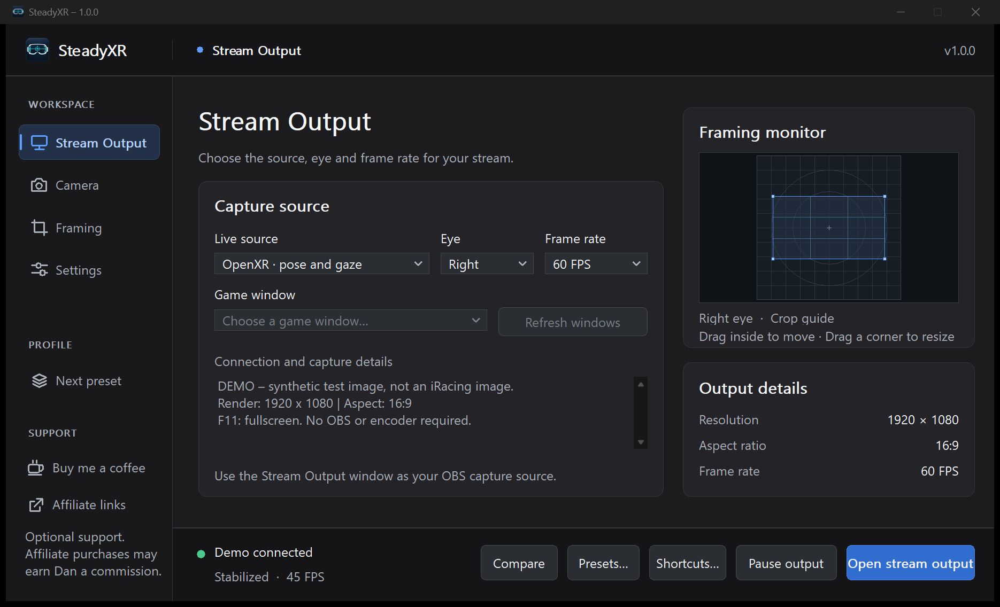
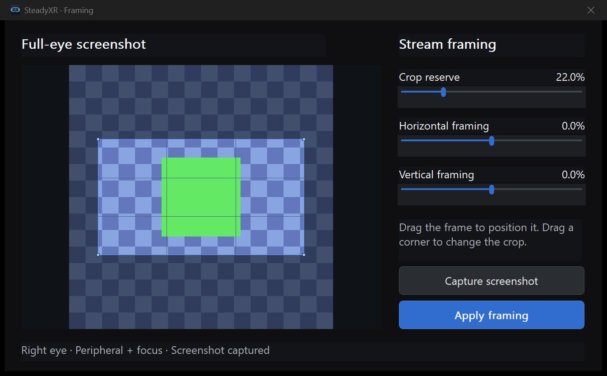

# SteadyXR

**Made by a streamer, for streamers.** A glance at the dash feels natural in the headset. On stream, that same movement can send the whole cockpit bouncing across the screen. I built SteadyXR so I could drive normally and give viewers a steadier shot.

SteadyXR is a standalone Windows app. It takes an OpenXR eye image or an existing game window, smooths the camera movement, and opens a clean **Stream Output** window. You choose what stays in frame.

**[Download SteadyXR 1.0.1 for Windows x64](https://github.com/DSuzuki35/steadyXR/releases/download/v1.0.1/SteadyXR-1.0.1-Standalone-Windows-x64.zip)** · [Illustrated user guide](preview/README.md) · [Release notes and checksums](https://github.com/DSuzuki35/steadyXR/releases/tag/v1.0.1)



## Go live

1. Extract the whole ZIP and start **SteadyXR.exe**.
2. On **Stream Output**, choose your source. For head-pose stabilization, choose **OpenXR**. If SteadyXR offers to install or update its OpenXR connection on startup, accept, then restart the game. You can also install it later from **Settings**. To capture a game mirror, choose **Capture a game window** and select its window.
3. Choose **Dan Suzuki** from **Choose preset…** in the top-right corner of the dashboard to try my 4K setup. Under **Camera**, look straight ahead with your headset upright and click **Center camera**.
4. Open the output. Use the setup that matches your stream.

| Your setup | Where the picture goes |
| --- | --- |
| **Single PC** | In OBS, add a **Window Capture** source and select **SteadyXR – Stream Output**. |
| **Dual PC** | In SteadyXR **Settings → Output monitor**, select the display connected to your capture card. Put Stream Output fullscreen there with **F11**. On the streaming PC, use the capture card as your video source. |

For a 72 Hz headset, choose **72 FPS** to match a steady 72-frame OpenXR source. A **60 FPS** cap skips about 12 source frames each second. A **90 FPS** cap can also show all 72, since the source sets the upper limit.

## Frame a lap

On **Framing**, click **Capture full eye**, then **Edit captured frame…**. Drag the rectangle to line up the dash and the road, or drag a corner to change the crop. **Apply framing** sends the new shot to the stream. The still uses the whole selected eye. If the game supplies peripheral and high-resolution focus images, SteadyXR combines them.



You can also frame the shot directly in the dashboard's **Framing monitor**. Drag inside the crop rectangle to move the shot, or drag a corner of the rectangle to change how much of the eye reaches the stream. Dashboard edits change Stream Output immediately. The separate still editor lets you adjust a draft before you click **Apply framing**.

For normal streams, I recommend **Camera → Smoothing**. When **Director → Enable lookahead** supplies the OpenXR camera pose, lookahead replaces ordinary smoothing. **Enable automatic crop** and **Enable speed framing** on their own keep your normal smoothing.

## Controls and setup

| I want to… | Where to go |
| --- | --- |
| Smooth head movement or level the horizon | [Camera, adaptive leveling and centering](preview/README.md#camera) |
| Change crop, mirror edges or request more rendered scenery | [Framing, render extensions and their GPU cost](preview/README.md#framing) |
| Set the output resolution, aspect ratio or fullscreen display | [Settings and output](preview/README.md#settings-and-output) |
| Configure OpenXR capture, extra overlays, eye tracking or visual effects | [Connection, layers and overlays](preview/README.md#connection-layers-and-overlays) · [Gaze and effects](preview/README.md#gaze-and-effects) |
| Assign a wheel button to capture a still, center the camera or switch presets | [Presets, shortcuts and comparison](preview/README.md#presets-shortcuts-and-comparison) |
| Diagnose a black window, a missing focus image or a capture conflict | [Troubleshooting](preview/README.md#troubleshooting) |
| Update, move settings to another PC or uninstall | [Files, updates and removal](preview/README.md#files-updates-and-removal) |

OpenXR capture supports D3D11 and D3D12. The stream dashboard reports whether the capture layer received a single image or both peripheral and focus images for the selected eye. The screenshots use SteadyXR's synthetic demo. The checkerboard is the peripheral image and the green patch is the focus image.

## Support

If SteadyXR earns a spot in your streaming setup, you can support my work. Purchases through affiliate links may earn me a commission. [Buy me a coffee](https://buymeacoffee.com/dansuzuki) · [Affiliate links and sim racing discounts](https://dansuzuki.com/discounts/)

For a bug report, include the SteadyXR version, game, headset, OpenXR runtime and the text shown under **Connection and capture details**. [Report an issue](https://github.com/DSuzuki35/steadyXR/issues)

## Build from source

On Windows x64, install Visual Studio 2022 with **Desktop development with C++**, a Windows SDK and CMake 3.24 or newer. The OpenXR headers are included in the repository.

```powershell
cmake -S . -B build -A x64 -DVRST_BUILD_PREVIEW=ON
cmake --build build --config Release --parallel
ctest --test-dir build -C Release --output-on-failure
```

The app and capture layer are built in `build/preview/Release`. The downloadable release includes the signed app, capture layer, updater, OpenXR layer manifest and illustrated guide. [Update and release packaging](docs/standalone-updates.md)

## License

Original SteadyXR standalone code and assets in this public release are source-available under **PolyForm Noncommercial 1.0.0**. Earlier license grants remain valid. Third-party components retain their own terms. [License](LICENSE) · [Third-party notices](THIRD-PARTY-NOTICES.md)
