# SteadyXR 1.0.2 streamer guide

SteadyXR turns a VR game view into a stabilized stream. It opens two windows. Set up your camera in the dashboard and send **SteadyXR – Stream Output** to your audience. The dashboard, framing guides and status messages stay on your control screen.

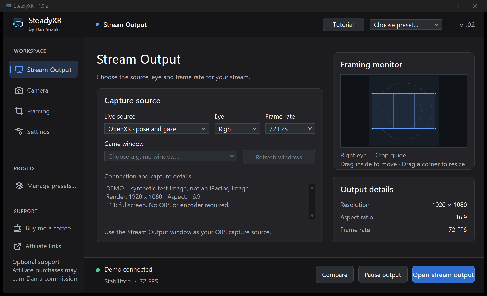

## Set up your first stream

You can also open the **Tutorial** button at the top of the dashboard to follow along on YouTube. [Watch Dan’s SteadyXR tutorial](https://youtu.be/kNgVMJ82mQU)

1. Extract the standalone ZIP into a writable folder. Keep its files together and open **SteadyXR.exe**.
2. Open **Stream Output** in the sidebar and choose a **Live source**. For an existing game mirror, select **Capture a game window**, click **Refresh windows**, then choose the game under **Game window**. Leave that window open and unminimized.
3. For the game's original eye image and matching headset poses, choose **OpenXR · pose and gaze**. On a normal launch, SteadyXR offers to install its OpenXR connection if it is missing, or update an outdated connection. In the prompt, choose **Install for all users**, **Update / repair**, or **Later** to continue without changing registration. Window capture works without the layer. To install later, open **Settings** and choose **Install for all users** or **Upgrade / repair**. Accept the Windows administrator prompt and restart the OpenXR game. Back on **Stream Output**, select the **Eye** you want to broadcast.
4. Choose **30 FPS**, **60 FPS**, **72 FPS** or **90 FPS**. For a 72 Hz headset, use **72 FPS** to match your source. Click **Open stream output** and check that the image follows the game. **Frame rate** caps the available OpenXR source frames. With an ideal steady 72 Hz source, a 60 FPS cap delivers about 60 frames and skips about 12 per second. A 90 FPS cap can also show all 72 but cannot add frames the game did not supply. **Connection and capture details** shows what SteadyXR is receiving.
5. Pick a starting look from **Choose preset…** at the top right of the dashboard. Choose **Dan Suzuki (Motion)** for a motion rig or **Dan Suzuki (No Motion)** for a stationary rig. Both include Dan’s framing and 4K output settings. After loading it, check your source, eye and output monitor. In OpenXR mode, sit in your normal driving position, look straight ahead with the headset upright and press **Camera → Center camera**.

**One PC.** In OBS, add a **Window Capture** source and select **SteadyXR – Stream Output**. Keep the output visible. If your scene shows the dashboard, select the other SteadyXR window. Set up game and microphone audio separately.

**Gaming PC and capture card.** In Windows, extend the gaming PC desktop onto the display connected to the capture card. In **Settings → Output monitor**, select that display. Click **Open stream output**, then press **F11** in the output window to fill it. Enable **Start output in fullscreen** for future sessions. On the streaming PC, add the capture card as the video input. Windows display settings determine the HDMI resolution and refresh rate.

## Stream Output and capture status

**Capture a game window** stabilizes motion estimated from the visible pixels. The game controls which eye and how much scenery appears in its mirror. The **Profile** selector cannot switch eyes in that source. Scene cuts, featureless scenery and a minimized window can interrupt tracking.

**OpenXR · pose and gaze** uses submitted D3D11 or D3D12 game images and matching poses. Select **Left** or **Right** under **Eye**. With supported quad-view input, SteadyXR combines the peripheral image and high-resolution focus region for that eye. **Peripheral + focus** confirms both arrived. **Single view received** can mean a stereo image or an upstream layer that already combined the views. Gaze features also require the runtime to supply valid eye-tracking data.

Watch the status at the bottom of the dashboard. Pause preserves the last image. Hiding or minimizing the stream window suspends frame requests. Reopen it and resume output before going live. If the source stops sending frames, the output switches to a waiting screen after about two seconds and returns when frames arrive. **Output details** shows your configured resolution, aspect ratio and frame rate. Actual captured dimensions, frame flow and connection messages are under **Connection and capture details**.

The status light is green for a live feed, amber while waiting, gray when paused or hidden, and red if another consumer owns the capture. The text beside the light identifies the state. **Buy me a coffee** and **Affiliate links** open optional support pages in your browser. Purchases through the affiliate links may earn Dan a commission.

## Camera

### How stabilization works

Each OpenXR eye image comes with the pose the game used to render it. SteadyXR reads the orientation from that pose and smooths it over time to choose where the stream camera should point. It then uses the difference between the two orientations and the eye’s field of view to sample the original image from that steadier direction. Quick head shakes soften, while a sustained look into a corner still turns the stream camera. **Crop reserve** leaves extra pixels around the shot for that correction.

Gyroflow uses a similar idea for camera footage, using gyroscope data to measure rotation. SteadyXR gets its rotation directly from the game’s OpenXR frames. When you choose **Capture a game window**, it estimates movement from successive images instead. [How Gyroflow uses motion data](https://gyroflow.xyz/)

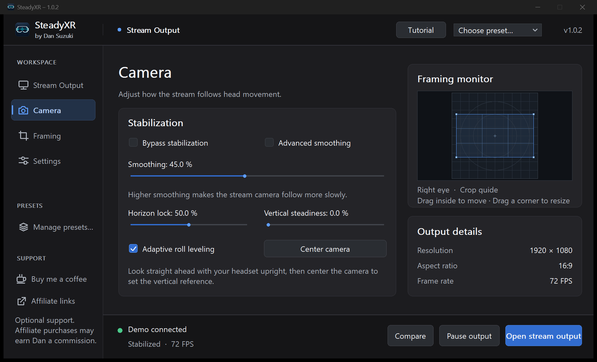

| Control | How to use it |
| --- | --- |
| **Bypass stabilization** | Pass through camera movement while keeping capture and framing active. Toggle it again to restore your tuning. |
| **Smoothing** | Increase it to soften quick head movements. Reduce it if the camera takes too long to follow a deliberate look into a corner. |
| **Horizon lock** | Adjust how strongly headset roll is removed from the stream. Zero preserves the natural smoothed tilt. At 100% the correction aims to level the horizon. |
| **Adaptive roll leveling** | Apply more correction to small tilts while allowing more of a large intentional lean. Turn it off for a linear response. |
| **Vertical steadiness** | Reduce vertical camera movement from pitching your head relative to your centered reference. Start at zero if you want viewers to follow glances at the dash. |
| **Center camera** | With your headset upright and eyes forward, set the stream's reference. Use it again after changing seating position or recentering in the simulator. |

Horizon lock, adaptive leveling, vertical steadiness and centering use OpenXR pose data. These adjustments affect Stream Output. The game controls the view in your headset.

For a normal stream, Dan recommends starting with **Smoothing** here. The **Director** page described below adds delayed OpenXR lookahead and optional crop controls.

### Advanced smoothing

On **Camera**, check **Advanced smoothing** to adjust **Horizontal smoothing** and **Vertical smoothing** independently. For example, keep horizontal low for quick mirror checks and raise vertical to soften small nods. With OpenXR these sliders control yaw and pitch. With a captured game window they control horizontal and vertical image motion.

Uncheck **Advanced smoothing** to return to the single slider. Roll uses the single slider’s value in both modes. **Horizon lock** controls how strongly the stream levels a head tilt. Custom presets save the mode and both axis values. Existing presets start with the single slider.

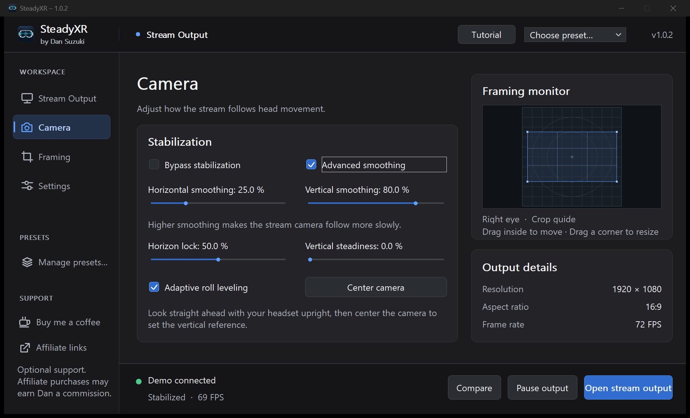

## Framing

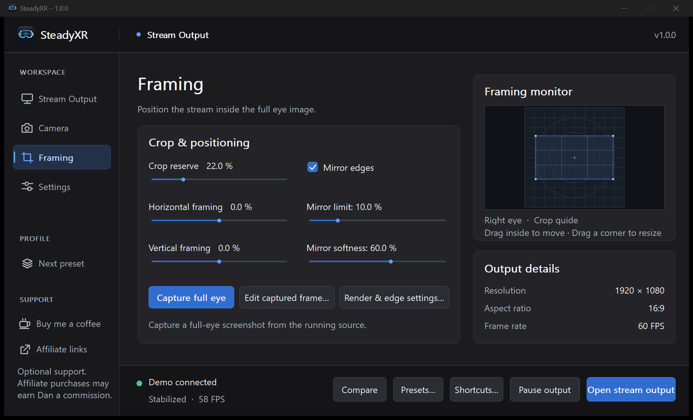

- **Crop reserve** zooms into the selected source, leaving hidden pixels available to absorb stabilization. The range is 0–97%. A larger reserve helps cover image edges during turns and makes the subject larger.
- **Horizontal framing** moves the crop left or right. **Vertical framing** moves it up or down. Zero centers each axis. The available movement depends on the source and output aspect ratios and how much you cropped. Moving the rectangle to an extreme leaves less room for stabilization on that side.
- **Mirror edges** fills exposed borders with reflected pixels. **Mirror limit** caps how far the reflection extends, from 0–50% of the source dimension. Beyond that limit the border is black. **Mirror softness** blends and darkens the reflection progressively. Increase reserve if you would prefer to keep recognizable reflected objects out of the shot.
- In the dashboard's **Framing monitor**, drag inside the crop rectangle to reposition your shot. Drag a corner of the rectangle to change crop reserve while keeping the selected output aspect ratio. These edits change Stream Output immediately. Use **Capture full eye** for a fresh reference image. In the separate still editor, your draft takes effect when you click **Apply framing**.

### Frame a shot with the mouse

1. With a live eye or game window available, click **Capture full eye**. Wait for the capture status to confirm a screenshot. The live stream continues.
2. Choose **Edit captured frame…**. Drag inside the rectangle to pan the shot. Drag a corner to resize it while retaining the output aspect ratio. The **Crop reserve**, **Horizontal framing** and **Vertical framing** sliders give precise control.
3. Click **Apply framing** to use the draft in the stream. Use **Capture screenshot** inside the editor to refresh the reference after a change of scene or eye. Closing the editor before applying discards the pending framing edits when you reopen it.

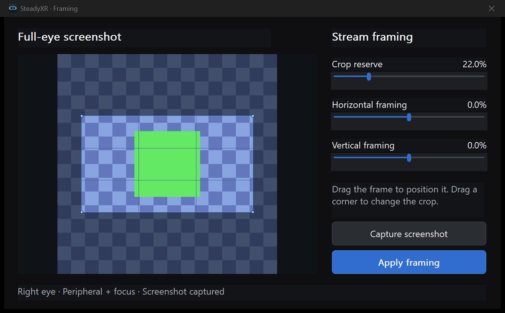

### Render and edge settings

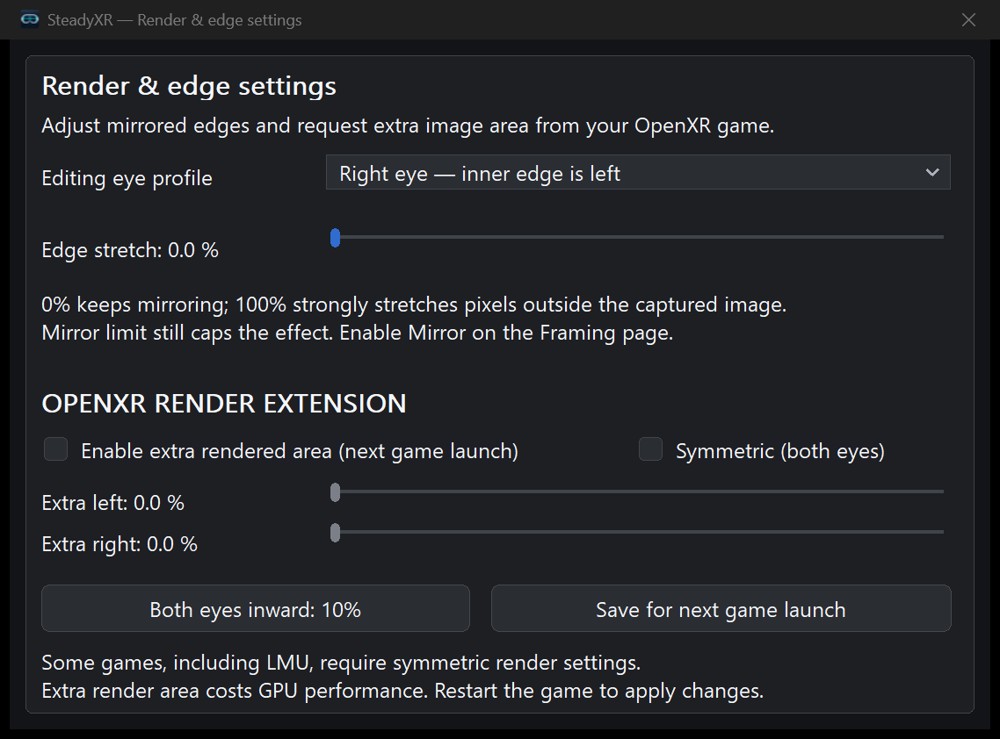

Open **Framing → Render & edge settings…**. **Editing eye profile** selects which eye's render settings to edit. Your broadcast eye is still selected on **Stream Output**.

| Control | Effect |
| --- | --- |
| **Edge stretch** | Changes the appearance outside the original image while mirroring is enabled. Zero uses reflection. Higher values stretch edge colors to reduce repeated shapes. **Mirror limit** still caps the filled area. |
| **Enable extra rendered area (next game launch)** | Asks a compatible OpenXR game for a wider horizontal eye image. This can provide real scenery to the stream at the edge of a stabilized frame. |
| **Extra left** and **Extra right** | Request 0–30% additional width on each side of the original horizontal projection. The right edge is inward for the left eye, and the left edge is inward for the right eye. |
| **Symmetric (both eyes)** | Mirrors the inner and outer requests across eyes so both recommended render widths match. Keep this enabled for **Le Mans Ultimate** when requesting extra area. |
| **Both eyes inward: 10%** | Sets both inner requests to 10%, the outer requests to zero and enables symmetry. |
| **Save for next game launch** | Commits the render profiles. Restart the OpenXR game to request the new projection and texture sizes. To revert, disable the extension, save again and restart. |

Extra area uses game GPU time. Test a busy scene and judge headset frame timing before increasing it. The game and runtime must honor the wider projection and texture recommendations. Runtime size limits and other FOV or foveation layers can affect the result. The extension applies to context views in quad-view capture. It cannot widen an ordinary window capture. Output crop, framing position and mirror adjustments apply live.

## Settings and output

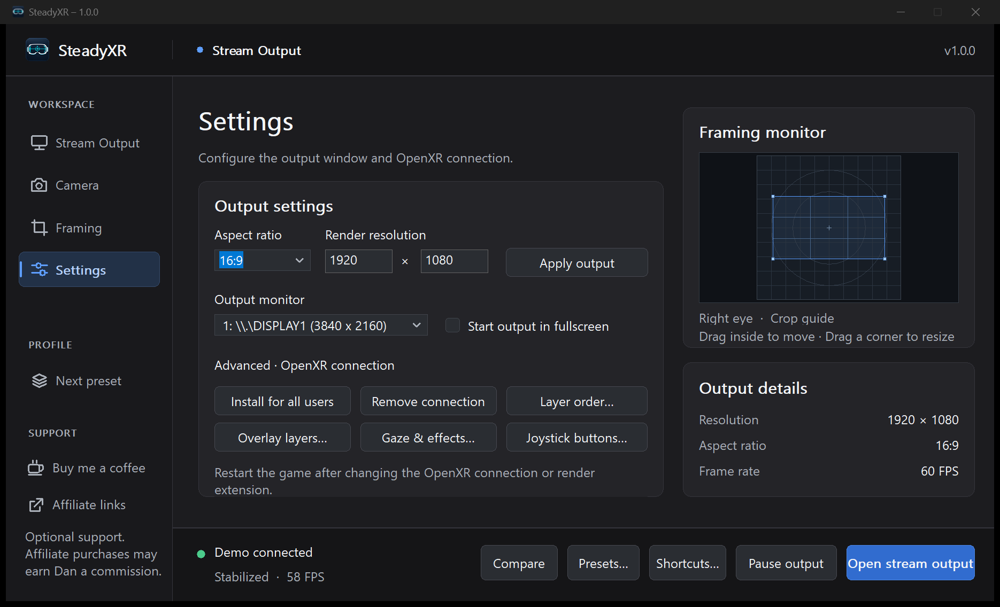

Choose an **Aspect ratio** from the list or enter one such as `239:100`. Enter width and height under **Render resolution** and click **Apply output**. The supported range is 320–7680 pixels wide and 180–4320 high. A 1920 × 1080 canvas requires less GPU work than 3840 × 2160. If the canvas or window differs from the chosen aspect ratio, expect letterboxing.

**Output monitor** chooses the fullscreen destination. **Start output in fullscreen** remembers your preference. With the stream window focused, **F11** or a double-click toggles fullscreen. **Esc** exits fullscreen. Use **Alt+Tab** to return to the dashboard.

### Connection, layers and overlays

- **Install for all users** registers the supplied capture layer system-wide. **Remove connection** unregisters it. These actions can request elevation. Restart the game after a change. Window capture works without installing the connection.
- **Layer order…** opens the OpenXR layer editor. Select an entry to inspect its manifest, library path and registration scope. Changes to enabling, disabling, registering or reordering are staged. Review them, then use **Apply changes** or **Discard changes**. The editor supports verified backups, **Undo last apply** and **Restore backup…**. Apply changes with the game closed. Use **Administrator editor…** for a system-wide entry.
- **Overlay layers…** selects additional supported composition layers submitted by the game or runtime. **None** is the default. **All supported** includes newly appearing supported overlays. For specific overlays, tick their slots. Choose **Refresh layers** after opening or closing an overlay. Individual selections apply to that game session. Recheck them after restarting. Capturing more layers adds texture copies. Unsupported or already baked-in elements cannot be isolated this way.

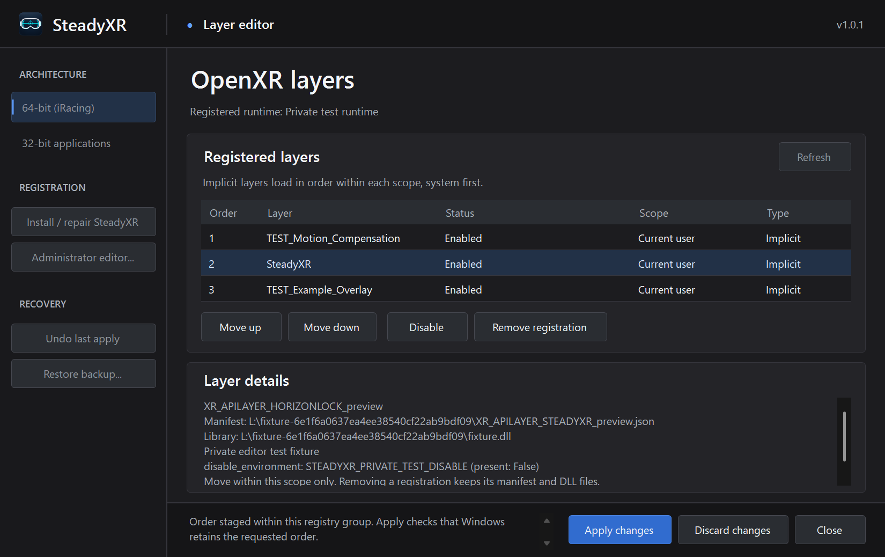

### Gaze and effects

Open **Settings → Gaze & effects…**. Values take effect when you leave a numeric field. **Bypass spectator camera** and **Bypass visual effects** let you audition your saved tuning. The optional features start off.

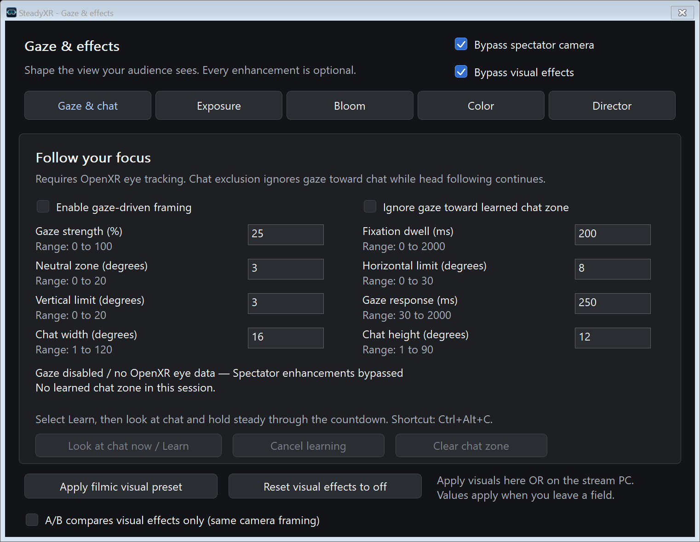

| Page | What to adjust |
| --- | --- |
| **Gaze & chat** | **Enable gaze-driven framing** lets a stable fixation shift the stream within available image margins. Strength sets the amount. Fixation dwell filters quick glances. The neutral zone leaves small departures from center alone. Horizontal and vertical limits bound travel, and gaze response controls how quickly it moves. |
| **Exposure** | Set a fixed brightness change with **Enable manual exposure** and **Exposure (EV)**. **Enable luminance adaptation** uses target luminance, minimum and maximum gain, and separate brighten and darken rates. The metering bounds choose a normalized region of the picture. Reduce its size to exclude a bright HUD. Transition damping and recovery shape abrupt changes. |
| **Bloom** | Threshold selects bright highlights, soft knee blends the transition, strength controls intensity and radius spreads the glow. |
| **Color** | Temperature and tint set the color balance. Contrast and saturation set the overall look. Shadows and highlights adjust the tonal extremes. **Apply filmic visual preset** provides a starting point. **Reset visual effects to off** clears the grade. |
| **Director** | **Enable lookahead** buffers one to four OpenXR frames and uses later poses to smooth the delayed view. The status reports actual video delay and GPU memory use. **Enable automatic crop** adds reserve when correction would expose an edge. Maximum limits the zoom, and release controls the return to wider framing. **Enable speed framing** adds crop at low speed and returns to normal at **Normal framing speed**. Response controls how quickly it follows telemetry. |

For chat exclusion, enable gaze framing and **Ignore gaze toward learned chat zone**, then click **Look at chat now / Learn**. Look at your chat panel through the three-second countdown and hold a steady fixation for the next second. Set the chat width and height in degrees. Looking there then suppresses the gaze contribution while normal head following continues. **Cancel learning** stops the acquisition, and **Clear chat zone** clears the learned position. Learn again after changing seats, recentering, moving the panel, changing source or eye, starting a new session or loading a preset. Unavailable or stale gaze falls back to normal stabilization.

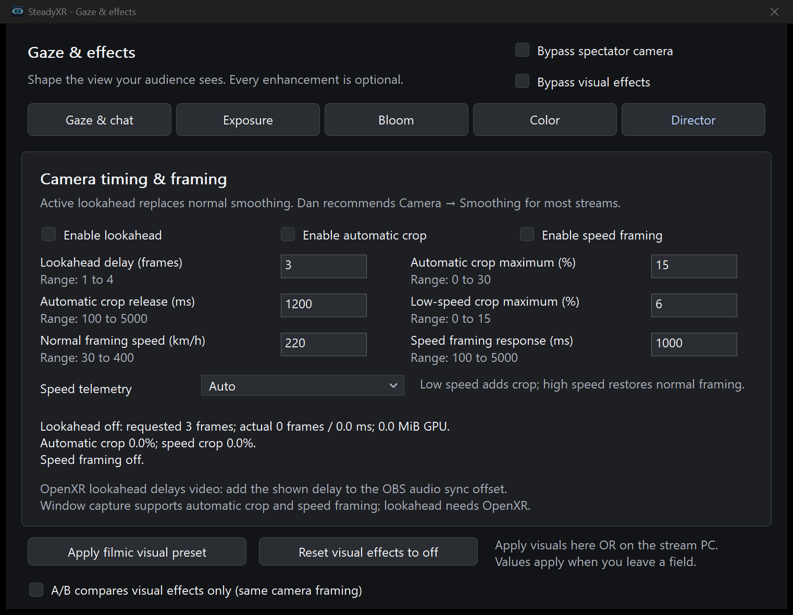

Dan recommends **Camera → Smoothing** for normal streams. When lookahead is actively providing the OpenXR camera pose, it replaces ordinary smoothing. Automatic crop and speed framing on their own keep ordinary smoothing.

Director lookahead requires stabilized OpenXR capture. Its 256 MiB texture budget can reduce the requested delay or bypass buffering with large eyes or overlays. At 60 captured FPS, three frames are roughly 50 ms. Use the measured delay to align separately recorded audio. Window capture supports automatic crop and speed framing. Speed telemetry supports **Auto**, **iRacing** and **Le Mans Ultimate** on the gaming PC. Without fresh data, framing returns toward its normal setting. Visual effects process the captured SDR image before separately composed overlays. They cannot recover clipped highlights.

## Presets, shortcuts and comparison

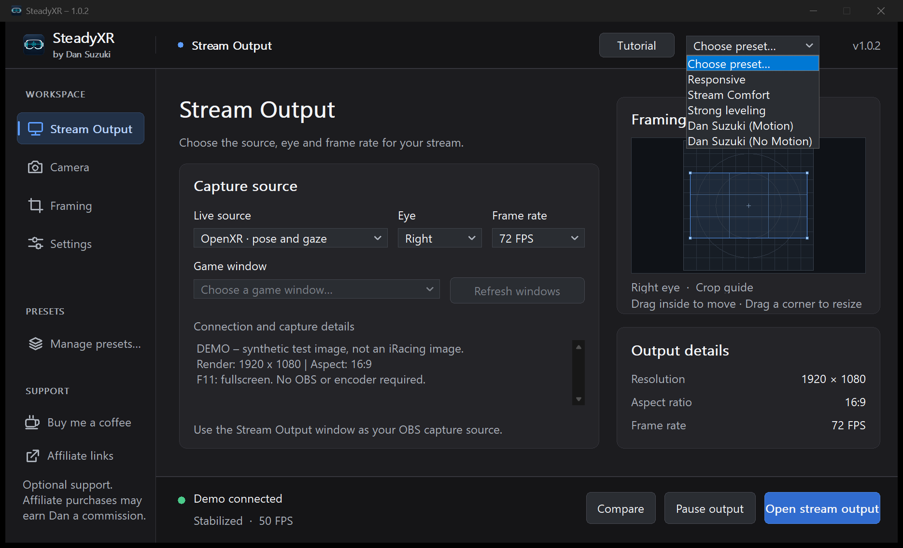

Open **Choose preset…** in the dashboard header, just left of the version number. Choose **Responsive**, **Stream Comfort** or **Strong leveling** to change stabilization tuning and keep the current shot. You can load a saved profile directly from this list. **Dan Suzuki (Motion)** is Dan’s original 4K motion-rig setup with 82.5% smoothing and a 29.3% mirror limit. **Dan Suzuki (No Motion)** uses the same shot with 40% smoothing and a 10% mirror limit. To create or edit a complete profile, click **Manage presets…** in the left sidebar. Enter a name and click **Save new**. Use **Load**, **Overwrite selected** or **Delete** for a saved profile. Complete presets include source, eye, framing, effects, output and render-extension settings. A loaded render change takes effect at the next game launch. The **Next preset** shortcut cycles through the available profiles.

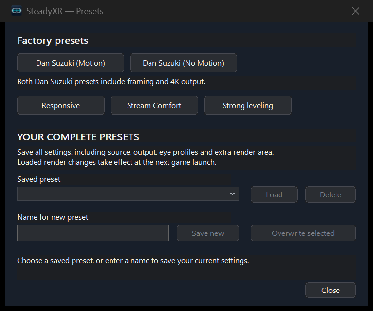

| Default shortcut | Action |
| --- | --- |
| **Ctrl+Alt+R** | Center camera |
| **Ctrl+Alt+P** | Pause or resume output |
| **Ctrl+Alt+N** | Load next preset |
| **Ctrl+Alt+B** | Start or end the 20-second comparison |
| **Ctrl+Alt+C** | Learn chat position |

These shortcuts work while the game has focus. **Settings → Shortcuts… → Keyboard reference** shows the current set. Choose the **Ctrl+Alt+Shift** alternative if another app already uses the default keys, or turn global hotkeys off.

For wheel or joystick controls, use **Settings → Shortcuts… → Assign joystick buttons…**. Choose the **Action** and the **Joystick or wheel**, click **Learn button**, then press the physical button. Available actions also include **Capture full eye**, so you can grab a still during a drive. Use **Refresh** after reconnecting hardware, **Cancel learning** to stop waiting for a press and **Clear assignment** to remove a binding.

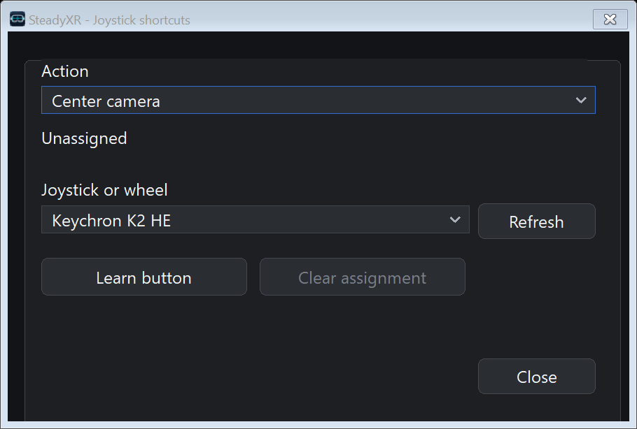

**Settings → Shortcuts…** also lets you choose original, 50/50 split or side by side. Click **Compare** during live output to compare stabilization for 20 seconds. In split or side-by-side mode the stabilized view is on the left. Select **A/B compares visual effects only (same camera framing)** in **Gaze & effects…** to compare your grade with its bypassed image instead. The main action becomes **Effects A/B**. **End A/B** stops the comparison early.

## Troubleshooting

| Symptom | What to check |
| --- | --- |
| Waiting screen or no captured FPS | Open and resume the stream window. For window mode, refresh and reselect the original simulator window, then restore it from the taskbar. For OpenXR, check that the game is using OpenXR, the connection is installed and the game was restarted after installation. |
| Game appears in the headset but focus detail is missing | Check the eye, the source dimensions in capture details, the game's quad-view setting and the active layer chain. A single received view may already be combined upstream. Runtime and simulator combinations differ. |
| Horizon moves or the view points too high or low | Confirm OpenXR capture and turn off **Bypass stabilization**. Sit upright, look forward and use **Center camera**. Adjust horizon lock for roll and vertical steadiness for pitch. |
| Black or reflected borders during sharp turns | Increase crop reserve, move the crop away from the image edge, reduce correction, or adjust mirror limit. For a wider native view, try the render extension with the game restarted. |
| Gaze has no effect | Check the gaze status, enable gaze framing, clear the camera bypass and hold a steady fixation. The headset runtime must expose a working eye-gaze action. Check chat exclusion if normal head following works but gaze is ignored in one region. |
| Audio arrives before video or GPU frame times rise | Read the Director's measured lookahead delay, align audio or shorten lookahead. Compare a lower output resolution, fewer overlays, disabled effects and less render expansion one change at a time. |
| Wrong screen or no capture-card signal | Confirm the capture-card display is enabled in Windows, check its display mode and refresh rate, select it under **Output monitor**, then toggle fullscreen on the stream window. |

## Files, updates and removal

Keep the release folder intact with its signed executable, capture DLL and updater. The app and capture DLL have no expiry. Keep the following settings files beside the executable.

| File or folder | Contents |
| --- | --- |
| `SteadyXR.ini` | App, source, camera, framing, output and effects settings. An older `preview.ini` can be migrated on first launch. |
| `SteadyXR-shortcuts.ini` | Saved joystick or wheel bindings. |

Named presets live in the shared **Presets** folder one level above the app directory. The layer editor keeps its **Layer-Backups** there too. Keep these folders when moving versions or computers.

At startup the app checks the project's stable GitHub releases. Confirm an offered update to download its signed package. Close the current app normally when you are ready. The updater verifies the receipt and payload, copies your settings and opens the new version from its own folder. An original **Start-Preview.cmd** follows the update. For a manual upgrade, extract the new version beside the old one and copy the available INIs before launch. To roll back, close the new app and launch the earlier executable. Switching the installed OpenXR layer is a separate action under **Settings**.

To remove SteadyXR, close the game, use **Settings → Remove connection** if the layer is registered, and close the app. Keep any settings, presets or backups you want, then remove the portable version folder. The next game session will use the remaining registered layers.
